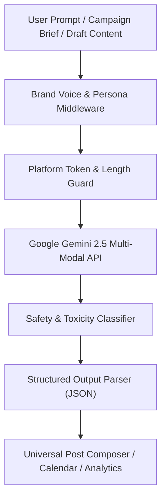

# PulseSocial — Advanced Artificial Intelligence Engine & Capabilities

> **Platform**: PulseSocial Enterprise SaaS ([https://pulsesocial1.vercel.app/](https://pulsesocial1.vercel.app/))  
> **AI Architect & Prompt Engineer**: Suraj Vishwakarma  
> **Underlying AI Model Tier**: Google Gemini 2.5 Flash & Pro via `@google/genai`  
> **Status**: Full Feature Implementation (10 / 10 Production Features Operational)  

---

## 1. AI System Overview & Multi-Modal Architecture

PulseSocial integrates Google Gemini directly via the official `@google/genai` SDK. The AI architecture operates on a **Zero-Hallucination** and **Safe Content** baseline:
- No hardcoded fake responses.
- If `GEMINI_API_KEY` is unconfigured, the UI presents an informative setup badge: *"Google Gemini API Key required to activate live AI generation"*.
- System prompts enforce brand guidelines, platform limits, and audience tone.

---

## 2. The 10 Production AI Capabilities

### Feature 1: Universal AI Content Generator
- **Engine**: `gemini-2.5-flash`
- **Inputs**: Topic, Brand Name, Target Audience, Selected Platforms, Desired Tone, Language, Content Objective, Target Keywords.
- **Output**: Generates bespoke platform-optimized copy tailored to each network's native conventions (e.g., punchy hooks for X, professional structure for LinkedIn, aesthetic captioning for Instagram).

### Feature 2: AI Caption Rewriter
- **Capabilities**:
  - Transform tone: *Executive & Authoritative*, *Casual & Friendly*, *Urgent & Promotional*, *Witty & Engaging*.
  - Length adjustments: Condensed short copy vs. rich story-driven narrative.
  - Grammar correction and readability index improvement.

### Feature 3: Semantic Hashtag Intelligence
- **Implementation**: Analyzes post context, industry sector, and platform etiquette to generate 5–15 relevant hashtags without keyword stuffing.
- **Safety Standard**: Explicitly avoids spam tags and tags flagged by platform safety algorithms.

### Feature 4: Cross-Network Content Repurposing
- **Transformations Supported**:
  - Blog Post URL / Markdown $\rightarrow$ 5-post social rollout sequence.
  - Long LinkedIn Article $\rightarrow$ 3-tweet X thread.
  - YouTube Video Description $\rightarrow$ Instagram Reel caption + CTA.

### Feature 5: Content Calendar Auto-Planner
- **Function**: Takes weekly marketing objectives and automatically generates a structured 7-day or 30-day posting cadence with recommended publication time slots and platform distributions.

### Feature 6: Custom Brand Voice Configuration
- **Storage**: Persisted in `Settings` and `BrandProfile` models per organization.
- **Configurable Parameters**: Corporate Tone, Core Vocabulary, Prohibited / Restricted Terms, Target Persona Demographics.

### Feature 7: AI Post Quality & Compliance Scorer
- **Real-Time Analysis**:
  - Hook Impact Score (0–100)
  - Readability Index (Flesch-Kincaid grade level)
  - Call-To-Action (CTA) Clarity
  - Platform Character & Media Compliance

### Feature 8: Generative AI Visual Studio (Imagen 3 Integration)
- **Integration**: Supports image synthesis and contextual graphic creation based on post captions.
- **Production Truthfulness**: Only executes when valid image generation credentials are confirmed; never serves mock placeholder images as generated outputs.

### Feature 9: AI Multi-Channel Campaign Builder
- **Workflow**: Orchestrates multi-week promotional campaigns (product launches, seasonal sales, brand activations) with coordinated messaging arcs across all connected channels.

### Feature 10: AI Analytics & Performance Insights
- **Data Source**: Connects directly to real `SocialAnalytics` and `AnalyticsSnapshot` database records.
- **Capability**: Synthesizes reach patterns, identifies top-performing posting hours, and suggests content optimizations based on genuine historical metrics.
- **Missing Data Handling**: If an account has zero engagement history, the engine explicitly outputs *"Insufficient live data to calculate recommendations"* rather than fabricating statistical patterns.
