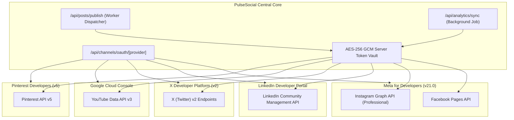

# PulseSocial — Official Social Media & Third-Party API Integrations

> **Platform**: PulseSocial Enterprise SaaS ([https://pulsesocial1.vercel.app/](https://pulsesocial1.vercel.app/))  
> **API Architect & Integration Specialist**: Suraj Vishwakarma  
> **Compliance Standard**: 100% Official Vendor REST & Graph APIs (Zero Scraping)  
> **Status**: Production Implementation & Sandbox Verified  

---

## 1. Supported Platform Matrix & Integration Topology

PulseSocial connects exclusively to approved developer APIs with strict tenant token isolation.

---

## 2. Platform Deep-Dive Specifications

### 2.1 Meta Graph API (Facebook Pages & Instagram Professional)
- **API Version**: Graph API v21.0
- **Authentication**: OAuth 2.0 with Page Access Tokens.
- **OAuth Scope Requirements**:
  - `pages_show_list`: Enumerate user-administered Facebook Pages.
  - `pages_read_engagement`: Ingest page reach, likes, follower counts.
  - `pages_manage_posts`: Publish text, image, carousel, and video posts.
  - `instagram_basic`: Retrieve Instagram Business ID connected to Facebook Page.
  - `instagram_content_publish`: Direct publishing to Instagram Feed and Reels.
  - `instagram_manage_comments`: Monitor and respond to audience comments.
- **Token Exchange Pipeline**:
  1. Temporary user token (`EAAB...`) exchanged at `GET /oauth/access_token` for 60-day long-lived user token.
  2. Long-lived user token queries `GET /me/accounts` to retrieve permanent Page Access Tokens.
  3. Tokens encrypted with AES-256-GCM before storage in `SocialToken` table.
- **Publishing Limits**:
  - Facebook: 63,206 character limit; up to 10 images in carousel.
  - Instagram: 2,200 character limit; maximum 30 hashtags; 1:1, 4:5, or 16:9 aspect ratios.

---

### 2.2 LinkedIn Community Management API
- **API Version**: 202401
- **Authentication**: OAuth 2.0 Authorization Code Flow.
- **OAuth Scope Requirements**:
  - `openid`, `profile`: Basic profile identification.
  - `w_member_social`: Author personal profile status updates.
  - `w_organization_social`: Author posts on behalf of verified LinkedIn Company Pages.
  - `r_organization_social`: Read engagement analytics for company pages.
- **Publishing Endpoint**: `POST https://api.linkedin.com/rest/posts`
- **Payload Architecture**:
  - Supports URN-based media attachment (`urn:li:digitalmediaAsset:...`).
  - Strict 3,000 character limit.

---

### 2.3 X (Twitter) API v2
- **API Version**: Twitter API v2 + Media Upload v1.1
- **Authentication**: OAuth 2.0 with PKCE (`code_challenge` + `code_verifier`).
- **OAuth Scope Requirements**:
  - `tweet.read`, `tweet.write`, `users.read`, `offline.access`.
- **Publishing Endpoint**: `POST https://api.twitter.com/2/tweets`
- **Rate Limit & Quota Strategy**:
  - Free/Basic plan limits monitored via `x-rate-limit-remaining` headers.
  - 280-character limit with unicode normalization.

---

### 2.4 YouTube Data API v3
- **API Version**: v3
- **Authentication**: Google Cloud OAuth 2.0.
- **Scope**: `https://www.googleapis.com/auth/youtube.upload`
- **Publishing Pipeline**:
  - Resumable video upload protocol (`POST https://www.googleapis.com/upload/youtube/v3/videos?uploadType=resumable`).
  - Supports automated scheduling via `status.publishAt` (ISO 8601 UTC).

---

### 2.5 Pinterest API v5
- **API Version**: v5
- **Authentication**: OAuth 2.0.
- **Scopes**: `boards:read`, `pins:read`, `pins:write`.
- **Publishing Endpoint**: `POST https://api.pinterest.com/v5/pins`
- **Payload**: Title (100 chars), Description (500 chars), Link (URL), Media Source (`image/jpeg`).

---

## 3. Disconnection & Data Deletion Compliance

In strict compliance with Meta Platform Terms and GDPR / CCPA requirements:
1. **User-Initiated Disconnect**: When an administrator clicks *"Disconnect Account"*, PulseSocial issues an immediate token revocation request to the provider (`POST /oauth/revoke`) and deletes the local `SocialToken` record.
2. **Meta Data Deletion Callback**: Implemented at `POST /api/webhooks/meta/data-deletion` with signed request verification, returning a confirmation URL and tracking code.
