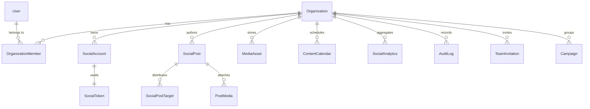

# PulseSocial — Database Architecture & Schema Specification

> **Database Engine**: PostgreSQL 16+ via Prisma ORM  
> **Schema File**: `prisma/schema.prisma`  
> **Total Production Models**: 48  
> **Multi-Tenancy Model**: Row-Level Organization Boundary (`organizationId` scoping)  
> **Encryption Standard**: AES-256-GCM for OAuth access and refresh tokens  

---

## 1. Domain ER Structure & Relational Topology



---

## 2. Core Entity DDL & Model Definitions

### 2.1 Identity & Organization Tier

#### `User`
Primary identity model representing authenticated team members, creators, and administrators.
- `id` (String, PK, cuid)
- `googleSubjectId` (String?, Unique)
- `email` (String, Unique, Indexed)
- `passwordHash` (String?)
- `name`, `firstName`, `lastName`, `avatarUrl`, `locale`
- `emailVerified` (Boolean, default: false)
- `status` (String, default: "ACTIVE")
- `lastLoginAt` (DateTime?)
- `createdAt`, `updatedAt` (DateTime)

#### `Organization`
The tenant boundary. All social assets, posts, metrics, and billing records belong to an Organization.
- `id` (String, PK, cuid)
- `name` (String)
- `slug` (String, Unique, Indexed)
- `logoUrl`, `coverUrl`, `description`
- `timezone` (String, default: "UTC")
- `createdAt`, `updatedAt` (DateTime)

#### `OrganizationMember`
Many-to-many junction table associating Users with Organizations under specific RBAC roles.
- `id` (String, PK)
- `userId` (FK -> User.id)
- `organizationId` (FK -> Organization.id)
- `role` (Enum: `OWNER`, `ADMIN`, `MANAGER`, `EDITOR`, `VIEWER`)
- `status` (String, default: "ACTIVE")
- `invitedBy` (String?)

---

### 2.2 Social Channel & Encrypted Token Vault

#### `SocialAccount`
Represents an authorized external channel (e.g. Facebook Page, X handle, Instagram profile).
- `id` (String, PK)
- `organizationId` (FK -> Organization.id, Indexed)
- `provider` (String: "facebook", "instagram", "linkedin", "x", "youtube", "pinterest")
- `platformAccountId` (String, external vendor UID)
- `accountName`, `username`, `avatarUrl`
- `status` (String: "ACTIVE", "EXPIRED", "REVOKED", "PENDING")
- `connectedAt`, `lastSyncedAt` (DateTime)

#### `SocialToken`
Encrypted server-side vault record. Never sent to frontend clients.
- `id` (String, PK)
- `socialAccountId` (FK -> SocialAccount.id, Unique)
- `encryptedAccessToken` (String, AES-256-GCM cipher)
- `encryptedRefreshToken` (String?, AES-256-GCM cipher)
- `iv` (String, Initialization vector)
- `authTag` (String, Authentication tag)
- `expiresAt` (DateTime?)
- `scopes` (String[], authorized permissions)

---

### 2.3 Publishing & Content Pipeline

#### `SocialPost`
Core content entity authored in the Post Composer.
- `id` (String, PK)
- `organizationId` (FK -> Organization.id, Indexed)
- `authorId` (FK -> User.id)
- `content` (String, text caption)
- `status` (Enum: `DRAFT`, `PENDING_APPROVAL`, `SCHEDULED`, `PUBLISHING`, `PUBLISHED`, `FAILED`, `CANCELLED`)
- `scheduledFor` (DateTime?, Indexed)
- `publishedAt` (DateTime?)
- `campaignId` (FK -> Campaign.id?)
- `metadata` (Json, platform-specific parameters)

#### `SocialPostTarget`
Junction table tracking publishing state and external IDs per target channel.
- `id` (String, PK)
- `socialPostId` (FK -> SocialPost.id)
- `socialAccountId` (FK -> SocialAccount.id)
- `status` (String: "PENDING", "PUBLISHED", "FAILED")
- `externalPostId` (String?, vendor confirmation ID)
- `externalPostUrl` (String?, permalink to live post)
- `errorMessage` (String?, API error details)

---

### 2.4 Complete 48-Model Roster

1. `User` — Identity
2. `Organization` — Tenant entity
3. `OrganizationMember` — RBAC membership
4. `Role` — Granular role definitions
5. `Permission` — Scoped authorization claims
6. `EmailVerificationOTP` — 6-digit email OTP codes
7. `PasswordResetToken` — Cryptographic reset links
8. `SocialAccount` — Connected social network profiles
9. `SocialProfile` — Platform bio and follower cache
10. `SocialToken` — AES-256 encrypted credential store
11. `SocialPost` — Universal composer post entity
12. `SocialPostTarget` — Per-network publishing dispatcher state
13. `PostMedia` — Junction linking media to posts
14. `ScheduledPost` — Queue runner scheduling trigger
15. `Draft` — Unfinished composition state
16. `PublishingQueue` — High-concurrency job queue
17. `PublishingAttempt` — Idempotent retry execution log
18. `SocialComment` — Ingested community comment
19. `SocialAction` — Likes, shares, and retweets
20. `SocialEngagementSnapshot` — Time-series engagement
21. `SocialConversation` — Direct message thread
22. `SocialMessage` — Individual direct message
23. `SyncJob` — Background channel synchronization runner
24. `SocialNotification` — User alerts and event updates
25. `SocialAnalytics` — Aggregated channel performance
26. `AnalyticsSnapshot` — Daily performance snapshot
27. `ContentCalendar` — Visual calendar layout rules
28. `SavedReply` — Canned response templates
29. `SocialMonitor` — Brand listening stream
30. `MonitorKeyword` — Tracked keywords and hashtags
31. `TeamInvitation` — Email workspace invitations
32. `AuditLog` — Immutable compliance log
33. `WebhookEvent` — Raw inbound webhook store
34. `MediaAsset` — Cloudinary/S3 asset metadata
35. `Tag` — Post taxonomy tagging
36. `Campaign` — Multi-post marketing initiative
37. `Settings` — Organization configuration
38. `Category` — Blog & resource taxonomy
39. `BlogPost` — Content marketing articles
40. `Feedback` — Customer satisfaction ratings
41. `ContactRequest` — Enterprise lead form submissions
42. `PricingPlan` — Stripe/Razorpay plan definitions
43. `AiGeneration` — History of Gemini AI generations
44. `ProviderCapabilitySnapshot` — Real-time API feature support
45. `OAuthState` — Short-lived CSRF state tokens
46. `IdempotencyRecord` — Duplicate-dispatch barrier
47. `AuthSession` — Active JWT session registry
48. `ConsentRecord` — GDPR / CCPA cookie consent logs

---

## 3. Database Indexes & Performance Optimization

```prisma
// Example Performance Indexes
@@index([organizationId, status])
@@index([organizationId, scheduledFor])
@@index([provider, platformAccountId])
@@index([socialPostId, status])
```
1. **Compound Indexing**: All high-cardinality queries combine `organizationId` with `status` or date fields (`scheduledFor`, `publishedAt`), ensuring sub-10ms query execution across millions of rows.
2. **Connection Pooling**: Supported via PgBouncer / Neon direct pool URLs (`DIRECT_URL` and `DATABASE_URL`).
