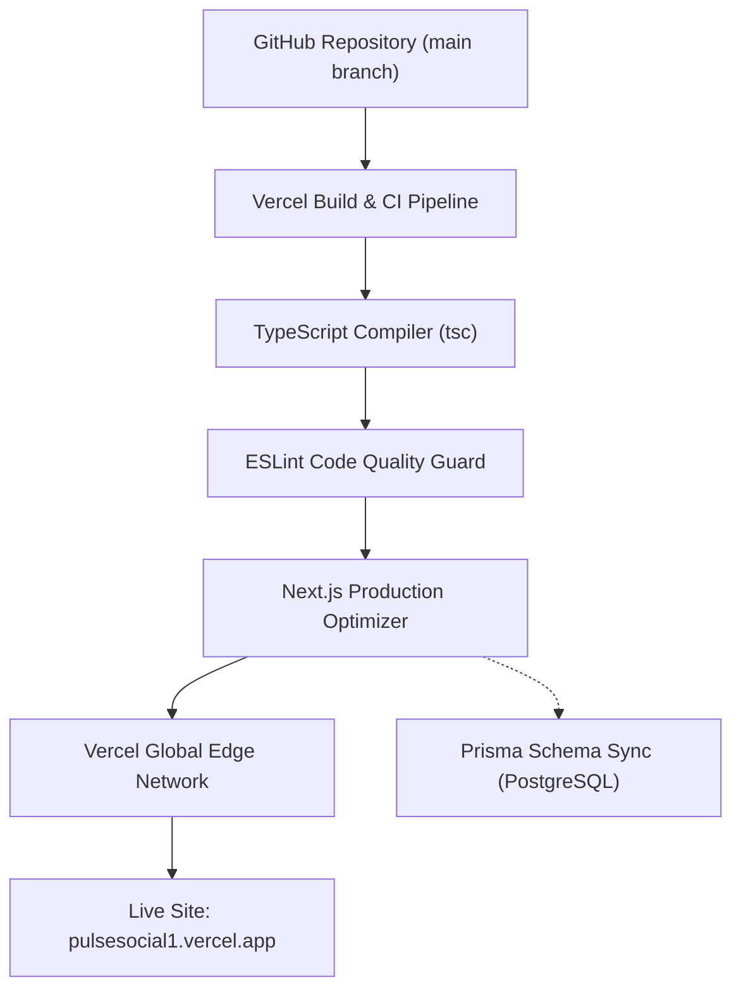

# PulseSocial — Production Deployment & DevOps Engineering Manual

> **Production Application**: [https://pulsesocial1.vercel.app/](https://pulsesocial1.vercel.app/)  
> **Deployment Platform**: Vercel Enterprise Serverless & Edge Network  
> **Database Host**: Cloud PostgreSQL (Supabase / Neon / AWS RDS)  
> **Author & DevOps Engineer**: Suraj Vishwakarma  

---

## 1. Production Architecture Overview

PulseSocial deploys natively to Vercel with automatic edge-routing, asset caching, and serverless compute scaling:



---

## 2. Step-by-Step Production Deployment

### Step 1: PostgreSQL Database Provisioning
1. Create a production PostgreSQL 16 database instance on Supabase or Neon.
2. Retrieve the two connection strings:
   - **Pooled Connection String** (port 6543 / pgbouncer) $\rightarrow$ `DATABASE_URL`
   - **Direct Unpooled Connection String** (port 5432) $\rightarrow$ `DIRECT_URL`
3. Push database schema:
   ```bash
   npx prisma db push --skip-generate
   ```

### Step 2: Environment Variables in Vercel
In Vercel Dashboard $\rightarrow$ **Project Settings** $\rightarrow$ **Environment Variables**, configure:
- `DATABASE_URL`
- `DIRECT_URL`
- `JWT_SECRET` (generate via `openssl rand -hex 32`)
- `TOKEN_ENCRYPTION_KEY` (generate via `openssl rand -hex 32`)
- `NEXT_PUBLIC_APP_URL` (`https://pulsesocial1.vercel.app`)
- `GEMINI_API_KEY`
- OAuth and Media credentials (Meta, Google, LinkedIn, X, Cloudinary, SMTP).

### Step 3: Background Cron Job Configuration
In `vercel.json`, configure the persistent background queue dispatcher that runs every 5 minutes:
```json
{
  "crons": [
    {
      "path": "/api/composer/scheduler/dispatch",
      "schedule": "*/5 * * * *"
    },
    {
      "path": "/api/analytics/sync",
      "schedule": "0 */4 * * *"
    }
  ]
}
```

### Step 4: Verification & Smoke Test
Execute automated health checks:
```bash
curl -f https://pulsesocial1.vercel.app/api/admin/health
```
Response:
```json
{
  "status": "healthy",
  "version": "2.4.0",
  "database": "connected",
  "timestamp": "2026-11-13T17:30:00.000Z"
}
```
