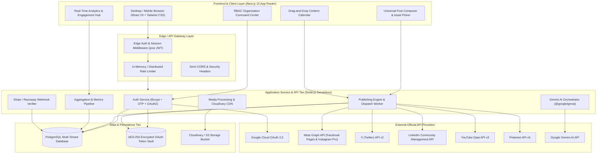
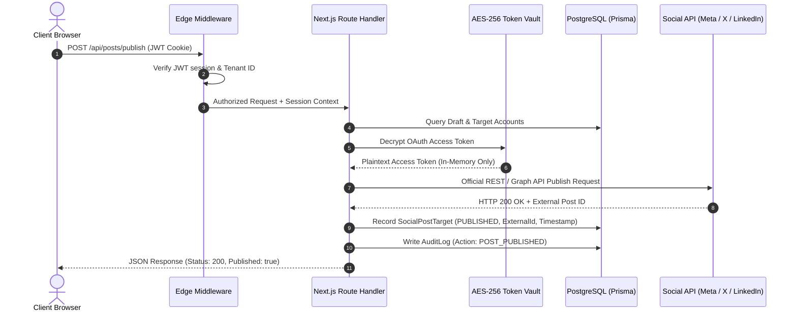
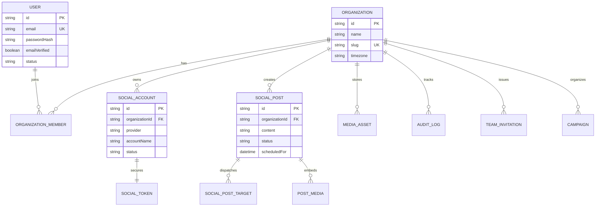
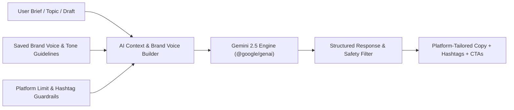

# PulseSocial — Enterprise System Architecture & Engineering Blueprint

> **Product**: PulseSocial — Unified Social Media Management & AI Publishing SaaS  
> **Production URL**: [https://pulsesocial1.vercel.app/](https://pulsesocial1.vercel.app/)  
> **Lead Architect & Engineer**: Suraj Vishwakarma  
> **Architecture Version**: 2.4.0 (Enterprise Production Specification)  
> **Document Status**: Production Complete  

---

## 1. Executive Architecture Summary

PulseSocial is an enterprise-grade, multi-tenant Software-as-a-Service (SaaS) platform engineered for brands, agencies, and high-growth creator teams to compose, schedule, publish, analyze, and monitor cross-network social media campaigns.

The system is built on **Next.js 15 (App Router)** with **TypeScript**, powered by a high-concurrency **PostgreSQL** persistence tier managed through **Prisma ORM**, and backed by **Google Gemini 2.5 Flash / Pro** for multi-modal generative copy, image synthesis, and sentiment analysis.

---

## 2. Frontend Architecture

### 2.1 Framework & Core Technologies
- **Framework**: Next.js 15.x utilizing the App Router paradigm (`/src/app`).
- **Language**: TypeScript 5.x with strict type-checking enabled (`noImplicitAny`, `strictNullChecks`).
- **Styling**: Tailwind CSS v3.4 with custom design tokens, dark/light theme switching (`next-themes`), and CSS custom properties.
- **Component Architecture**: Atomic component design separating marketing landing pages (`src/components/marketing/`), authenticated app shell (`src/components/dashboard/`), and complex modal workflows (`src/components/composer/`).
- **State Management**: React 19 hooks (`useActionState`, `useOptimistic`), lightweight context providers for Theme and Auth sessions, and URL-driven state for deep filtering (e.g., categories, calendar views, pagination).
- **Icons & Visuals**: Sharp, accessible SVG icons via `lucide-react` with dedicated brand SVG vectors in `PlatformIcons.tsx`.

### 2.2 Client-Side Route Topology

| Route Path | Auth Status | Purpose | Key Components |
|:---|:---|:---|:---|
| `/` | Public | Marketing Home, feature overview, platform pills | `HeroSection`, `PlatformMarquee`, `FeatureShowcase` |
| `/features` | Public | Comprehensive platform feature breakdown | `FeatureMatrix`, `FeatureDeepDive` |
| `/platforms` | Public | Detailed API capabilities per social network | `PlatformCapabilityTable`, `NetworkBadges` |
| `/solutions` | Public | Enterprise, agency, and creator solutions | `SolutionsHero`, `CaseStudies`, `MarketingFooter` |
| `/pricing` | Public | Billing tiers, annual discount toggle, FAQ | `PricingGrid`, `PlanComparison`, `FaqAccordion` |
| `/contact` | Public | Direct enterprise contact & callback dispatcher | `ContactForm`, `DepartmentSelector` |
| `/blog` | Public | Educational marketing & growth strategy articles | `BlogGrid`, `BlogHeader`, `CategoryFilter` |
| `/resources` | Public | Documentation, API references, guides | `ResourceLibrary`, `DocumentationLinks` |
| `/login` | Guest | User authentication (Password, Email OTP, Google) | `LoginForm`, `OtpVerificationModal` |
| `/signup` | Guest | Multi-step registration & organization creation | `SignupForm`, `PlanSelection` |
| `/dashboard` | Protected | Operational command center & recent metrics | `DashboardHeader`, `RecentPosts`, `ChannelStatus` |
| `/dashboard/composer` | Protected | Multi-network post authoring & scheduling | `PostComposerModal`, `MediaLibraryModal`, `GeminiAiModal` |
| `/dashboard/calendar` | Protected | Interactive content calendar (Month, Week, Day) | `ContentCalendarGrid`, `PostScheduleDrawer` |
| `/dashboard/analytics`| Protected | Live reach, impressions, and engagement metrics | `AnalyticsChart`, `PlatformPerformanceTable` |
| `/dashboard/channels` | Protected | OAuth connection manager & token status | `ChannelConnectModal`, `PermissionAudit` |
| `/dashboard/media` | Protected | Cloud asset manager & upload pipeline | `MediaLibraryGrid`, `AssetUploadZone` |
| `/admin/*` | Protected (Admin) | Enterprise system administration & audit logs | `AdminOverview`, `AuditLogViewer`, `TenantManager` |

---

## 3. Backend & API Gateway Architecture

### 3.1 Serverless API Architecture
All endpoints are implemented as Next.js 15 Route Handlers (`src/app/api/**/route.ts`) executing as serverless micro-functions on Vercel Edge / Node.js runtimes.

### 3.2 Tenant Isolation & Security Boundary
PulseSocial enforces a **Strict Organization Boundary** model:
1. Every authenticated user belongs to one or more organizations via `OrganizationMember`.
2. Every business entity (`SocialAccount`, `SocialPost`, `MediaAsset`, `Campaign`) carries a mandatory `organizationId` foreign key.
3. Every database query in API handlers explicitly includes `where: { organizationId: session.organizationId }`.
4. Role-Based Access Control (RBAC) verifies permissions (`OWNER`, `ADMIN`, `MANAGER`, `EDITOR`, `VIEWER`) prior to executing mutations.

---

## 4. Database Architecture & Schema Design

PulseSocial employs a relational PostgreSQL database schema with **48 synchronized tables** structured across 7 functional domains:

### 4.1 Core Domains
1. **Identity & Access Management**: `User`, `Organization`, `OrganizationMember`, `Role`, `Permission`, `EmailVerificationOTP`, `PasswordResetToken`, `AuthSession`, `ConsentRecord`.
2. **Channel & OAuth Vault**: `SocialAccount`, `SocialProfile`, `SocialToken`, `OAuthState`, `ProviderCapabilitySnapshot`.
3. **Publishing & Content Lifecycle**: `SocialPost`, `SocialPostTarget`, `PostMedia`, `ScheduledPost`, `Draft`, `PublishingQueue`, `PublishingAttempt`, `ContentCalendar`.
4. **Community Inbox & Engagement**: `SocialComment`, `SocialConversation`, `SocialMessage`, `SavedReply`, `SocialMonitor`, `MonitorKeyword`.
5. **Analytics & Metrics**: `SocialAnalytics`, `AnalyticsSnapshot`, `SocialEngagementSnapshot`, `SyncJob`.
6. **Media Asset Management**: `MediaAsset`, `Tag`, `Campaign`.
7. **Compliance & Audit**: `AuditLog`, `WebhookEvent`, `IdempotencyRecord`, `Feedback`, `ContactRequest`.

---

## 5. Official Social API Integrations

PulseSocial strictly implements official vendor APIs and OAuth 2.0 specifications. No unofficial scrapers or reverse-engineered private endpoints are permitted.

| Platform | Official API Tier | Auth Mechanism | Scopes Required | Supported Capabilities |
|:---|:---|:---|:---|:---|
| **Facebook Pages** | Meta Graph API v21.0 | OAuth 2.0 (Page Token) | `pages_show_list`, `pages_read_engagement`, `pages_manage_posts` | Feed posts, single image, carousel, video, comments |
| **Instagram** | Instagram Graph API v21.0 | Meta OAuth via FB Page | `instagram_basic`, `instagram_content_publish`, `instagram_manage_comments` | Feed photos, Reels, carousel, story publishing, metrics |
| **LinkedIn** | Community Management API | OAuth 2.0 (Authorization Code) | `openid`, `profile`, `w_member_social`, `w_organization_social` | Text posts, single image, multi-image, article links |
| **X (Twitter)** | X API v2 (Pay-as-you-go) | OAuth 2.0 PKCE | `tweet.read`, `tweet.write`, `users.read`, `offline.access` | 280-char tweets, media uploads via v1.1 endpoint, threads |
| **YouTube** | YouTube Data API v3 | Google OAuth 2.0 | `https://www.googleapis.com/auth/youtube.upload` | Video upload, Shorts, metadata editing, playlist assignment |
| **Pinterest** | Pinterest API v5 | OAuth 2.0 | `boards:read`, `pins:read`, `pins:write` | Board selection, image pins, destination links, metrics |

---

## 6. AI Generative & Multi-Modal Engine

The AI subsystem leverages Google's `@google/genai` SDK with **Gemini 2.5 Flash** as primary engine and **Gemini Pro** for complex strategy.

### 6.1 Implemented AI Capabilities
1. **Universal Social Copy Generator**: Generates platform-optimized variants (character limits, hashtag styles, hook placement).
2. **Brand Voice Tuner**: Stores brand tone (authoritative, conversational, witty), preferred keywords, and banned terms.
3. **Smart Caption Rewriter**: Instant tone transformation (casual, executive, urgency, engagement).
4. **Hashtag Intelligence**: Context-derived hashtags matching post semantics.
5. **AI Post Quality Scorer**: Real-time evaluation of readability, CTA strength, hook clarity, and compliance.
6. **Multi-Modal Image Generation & Editing**: Gemini / Imagen 3 API integration for generating branded visual assets.

---

## 7. Security Architecture & Threat Mitigation

- **Zero-Storage for Raw Passwords**: Passwords salted and hashed with `bcryptjs` (work factor 12).
- **OAuth Secret Encryption**: All OAuth `accessToken` and `refreshToken` records encrypted with AES-256-GCM before database insertion. Encryption keys maintained exclusively in server environment variables (`TOKEN_ENCRYPTION_KEY`).
- **CSRF & OAuth State Security**: Randomized, cryptographically secure `state` tokens stored in short-lived HTTP-only cookies validated upon OAuth redirect.
- **Strict Content Security Policy (CSP)**: Headers enforced on all responses preventing XSS, clickjacking, and unauthorized frame embedding.
- **Idempotency Protection**: `IdempotencyRecord` table prevents duplicate post dispatches during network retries or double clicks.

---

## 8. Deployment & CI/CD Pipeline

- **Hosting Platform**: Vercel Enterprise Serverless Platform.
- **Database**: Supabase / Neon Cloud PostgreSQL with connection pooling.
- **Edge CDN**: Vercel Global Edge Network with automatic Brotli/Gzip compression and image optimization via `next/image` and `sharp`.
- **Automated Quality Gates**:
  1. `npm run typecheck` (`tsc --noEmit`): 0 type errors.
  2. `npm run lint` (`eslint`): 0 fatal errors.
  3. `npx playwright test`: Full suite of functional, responsive, and regression tests.
  4. Production build: Next.js static and dynamic route optimization across all 164 paths.
